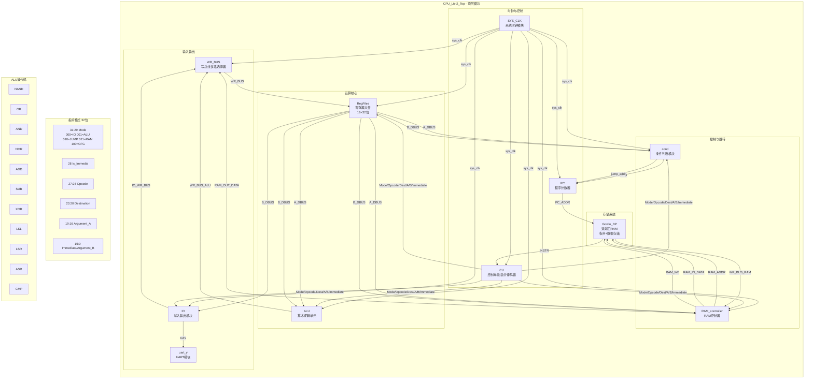
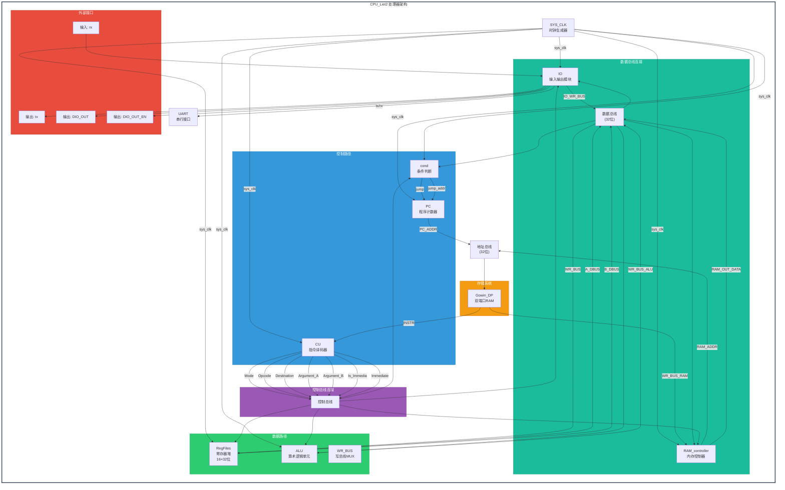

# 5级流水线CPU (Pipeline CPU)

这是一个基于FPGA实现的教学型CPU项目，其设计灵感来源于Turing Complete游戏中的Overture架构，旨在展示处理器的基本架构原理并验证计算模型的完备性。

## 项目概述

本项目正在实现一个5级流水线CPU，当前已完成基础模块设计，包括指令获取、译码、执行、内存访问和写回阶段。流水线控制逻辑和冒险处理正在优化中。

## 工具依赖

本项目使用了 [customasm](https://github.com/hlorenzi/customasm.git) - 一个开源的汇编器实现项目。customasm是一个功能强大的汇编器工具，用于将汇编代码转换为机器码，帮助我们更高效地编写和测试CPU指令。

## 目录结构

- `ASM/`: 包含汇编源代码、hex文件和转换脚本
    - `text.asm`: 汇编源文件
    - `text.hex`: 编译后的机器码
    - `HEX-MI.py`: hex转mi格式的Python脚本
- `CPU_Liet2/`: FPGA项目主目录
    - `src/`: Verilog源代码文件
        - `CPU_Liet2_Top.v`: 顶层模块
        - `PC.v`: 程序计数器
        - `CU.v`: 控制单元
        - `ALU.v`: 算术逻辑单元
        - `RegFile.v`: 寄存器文件
        - `SYS_CLK.v`: 系统时钟管理
        - `COND.v`: 条件判断单元
        - `RAM controller.v`: 内存控制器
        - `WR_BUS.v`: 写回总线
        - `IO.v`: IO接口模块
        - `gowin_dp/`: 双端口RAM IP核
        - `gowin_dpb/`: 双端口块RAM IP核
        - `gowin_osc/`: 振荡器IP核
        - `gowin_prom/`: PROM IP核
        - `gowin_rpll/`: PLL IP核
        - `spi_master/`: SPI主控制器
        - `uart/`: UART模块
- `DIO-IO/`: 配套的STM32驱动代码

## 当前架构特性

### 指令集架构 (ISA)
- 基于MIPS风格的精简指令集
- 支持R型、I型和J型指令格式
- 32个通用寄存器 (r0-r31)，其中r0恒为0

### 已实现模块
- **PC.v**: 程序计数器
- **CU.v**: 控制单元
- **ALU.v**: 算术逻辑单元
- **RegFile.v**: 寄存器文件
- **SYS_CLK.v**: 系统时钟管理
- **COND.v**: 条件判断单元
- **RAM controller.v**: 内存控制器
- **WR_BUS.v**: 写回总线
- **IO.v**: IO接口模块
- **Gowin_DP**: 双端口RAM，用作指令和数据存储器

### ALU功能
- 0: NAND (按位与非)
- 1: OR (按位或)
- 2: AND (按位与)
- 3: NOR (按位或非)
- 4: ADD (加法)
- 5: SUB (减法)
- 6: XOR (按位异或)
- 7: LSL (逻辑左移)
- 8: LSR (逻辑右移)
- 9: ASR (算术右移)
- 10: 比较操作

### COND模块功能 (新增)
- 新增Mode模式用于改变CPU内部状态（CPU_Mode_cfg）
- 支持直接进行条件判断和跳转
- 该功能目前尚未完全连接启用，后续将集成到流水线中，如果需要,你完全可以再实现一个寄存器来保存COND的状态更改他的判断模式是标志判断还是直接判断。

## 5级流水线架构

### 流水线阶段
- **IF (Instruction Fetch)**: 指令获取阶段 - 从指令存储器读取指令
- **ID (Instruction Decode)**: 指令译码阶段 - 解析指令并读取寄存器
- **EX (Execute)**: 执行阶段 - ALU运算和地址计算
- **MEM (Memory Access)**: 内存访问阶段 - 数据存储器读写
- **WB (Write Back)**: 写回阶段 - 将结果写回寄存器

### 已实现的流水线特性
- 基础5级流水线结构
- 指令和数据共享双端口RAM
- 简单的数据前递逻辑

### 当前挑战与优化方向
- **资源限制**: GW2AR-18器件的BSRAM资源有限（46块），需要优化内存配置
- **流水线冒险**: 数据冒险和控制冒险的检测与处理
- **时序优化**: 关键路径的时序约束和优化

## 模块组成

### 主要模块
- `CPU_Liet2_Top.v`: 顶层模块
- `PC.v`: 程序计数器
- `CU.v`: 控制单元
- `ALU.v`: 算术逻辑单元
- `RegFile.v`: 寄存器文件
- `SYS_CLK.v`: 系统时钟管理

### IP核
- `Gowin_DPB`: 双端口块RAM，用作指令存储器和数据存储器

## 设计特点

1. **教育导向**: 代码结构清晰，注释详尽，便于学习理解
2. **模块化设计**: 各功能模块独立实现，易于维护和扩展
3. **图灵完备性验证**: 设计目标是实现图灵完备的计算能力
4. **FPGA友好**: 针对Gowin FPGA架构优化设计
5. **受Turing Complete游戏启发**: 架构设计受到Turing Complete游戏中的Overture/LEG/Symphony架构启发

## 结构

## 使用方法

### 环境要求
- Gowin IDE (推荐v1.9.11以上版本)
- GW2AR-LV18QN88C8/I7 FPGA开发板
- [customasm](https://github.com/hlorenzi/customasm.git) 汇编器工具
- Python 3.x (如需运行辅助脚本)

### 编译步骤
1. 导入项目到Gowin IDE
2. 设置顶层模块为 `CPU_Liet2_Top`
3. 使用customasm编译ASM/目录下的汇编代码为机器码
4. 运行综合、布局布线
5. 生成编程文件并下载到FPGA

### 汇编代码处理流程
1. 在`ASM/`目录下编写汇编源代码
2. 使用customasm工具将汇编代码转换为机器码
3. 将生成的机器码加载到指令存储器中
4. 在FPGA上运行程序

## 图灵完备性说明

本项目的设计目标是实现一个图灵完备的CPU，这意味着它能够模拟任何图灵机的行为，具有执行任意可计算函数的能力。通过实现基本的算术逻辑运算、条件跳转和内存访问功能，我们的5级流水线CPU可以执行复杂的算法和程序。设计灵感来源于Turing Complete游戏，该游戏引导玩家从基本逻辑门开始逐步构建复杂的计算系统。

## 项目灵感

本项目的设计灵感主要来源于 [Turing Complete](https://turingcomplete.game/) 游戏，特别是游戏中的Overture架构。Turing Complete是一款教育类游戏，引导玩家从基本的逻辑门（如NAND门）开始，逐步构建复杂的逻辑电路，直至完成一个完整的CPU。该游戏展示了计算机架构、汇编语言和电子元件的工作原理，是本项目的重要参考。

## 开源协议

本项目采用 MIT 许可证，详情请参见 LICENSE 文件。

## 项目状态

**当前阶段**: 基础模块开发完成，正在进行流水线优化和资源调整

### 已完成
- [x] 基础指令集实现 (R型、I型指令)
- [x] ALU算术逻辑单元
- [x] 寄存器文件 (32个32位寄存器)
- [x] 程序计数器
- [x] 控制单元
- [x] 条件判断单元
- [x] 内存控制器
- [x] 双端口RAM集成
- [x] IO接口模块

### 进行中
- [ ] 流水线冒险处理优化
- [ ] 时序约束优化
- [ ] 资源使用优化（BSRAM限制）
- [ ] 分支预测机制

### 待实现
- [ ] 完整的异常处理
- [ ] 中断系统
- [ ] 扩展指令集

## 贡献指南

欢迎提交Issue和Pull Request来改进项目。对于重大变更，请先开Issue或者邮箱讨论变更内容。

## 致谢

感谢Gowin半导体提供的开发工具和FPGA器件支持。
感谢 [customasm](https://github.com/hlorenzi/customasm.git) 项目的开发者，为我们提供了优秀的汇编器工具。
感谢Turing Complete游戏的开发者，为我提供了构建CPU的教育性指导。

## 联系方式

邮箱：[hanqi38@outlook.com]
如有问题或建议，请通过Issue或邮箱联系我。